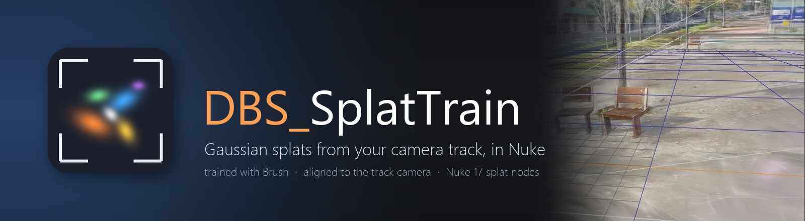
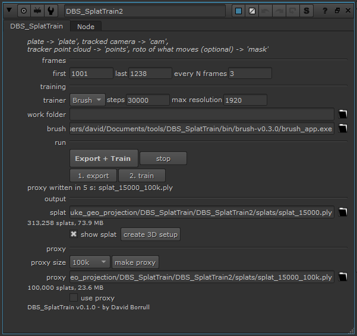

# DBS_SplatTrain

By David Borrull, VFX compositor. MIT licence (see LICENSE). Provisional name.

Nuke node: train a Gaussian splat from a shot that is already tracked in
Nuke, and bring it back aligned with the track camera.

```
Nuke     render every Nth frame (+ masks of what moves), CameraTracker camera per frame,
         tracker point cloud -> COLMAP binary (sparse/0) or transforms.json
  -> Brush (separate process, command line) trains the splat -> .ply
  -> Nuke 17 splat node, in the track's world
```

## Install

Requirements: **Nuke 17** (its splat nodes, GeoImport and SplatRender; Non-commercial works),
**Windows**, and a GPU that runs Brush (tested on an NVIDIA RTX 4060 Ti, 8 GB). Nothing to
install in Python: the node uses Nuke's own. Only tested on Windows so far.

1. **Get DBS_SplatTrain.** On GitHub, **Code > Download ZIP** (or the zip of a release) and
   unzip it anywhere, e.g. `C:/nuke_tools/DBS_SplatTrain`. Or
   `git clone https://github.com/dborrull/DBS_SplatTrain`.
2. **Get Brush v0.3.0.** From the [Brush v0.3.0 release](https://github.com/ArthurBrussee/brush/releases/tag/v0.3.0),
   download `brush-app-x86_64-pc-windows-msvc.zip` (159 MB) and unzip it so that the program ends
   up at `DBS_SplatTrain/bin/brush-v0.3.0/brush_app.exe`. Elsewhere works too: set its path in the
   node's `brush` knob.
   Optional, only for set photos: from the [COLMAP 4.2.1 release](https://github.com/colmap/colmap/releases/tag/4.2.1),
   download `colmap-x64-windows-cuda.zip` (415 MB, NVIDIA; `nocuda` otherwise) and unzip it into
   `DBS_SplatTrain/bin/colmap-4.2.1/` (so that `bin/colmap-4.2.1/bin/colmap.exe` exists), or set
   the node's `colmap` knob.
3. **Tell Nuke where it is.** Open (or create) `menu.py` in your `.nuke` folder
   (`C:/Users/<you>/.nuke/menu.py` on Windows) and add, with your own path:

   ```python
   nuke.pluginAddPath("C:/nuke_tools/DBS_SplatTrain/nuke")
   import DBS_SplatTrain
   DBS_SplatTrain.install_menu()
   ```

4. **Restart Nuke.** The node is in the Nodes toolbar under **DBS > DBS_SplatTrain** (and in
   **3D**).

Use Brush v0.3.0: later versions changed their command line (see Brush notes below).

## Use



1. Connect the plate to `plate`, the tracked camera to `cam`, the CameraTracker's point cloud to
   `points` and, if something moves, a roto of it (alpha) to `mask`. The plate must be
   undistorted (the cameras are pinhole).
2. Save the script: the export reads it from disk (the node saves it again if it has changes).
3. Press **Export + Train**. Progress shows under the buttons and in the node's label;
   Nuke stays usable. `stop` ends the current step.
4. When training ends, the node outputs the splat rendered through `cam`, in the working colour
   space (`show splat` off: the plate passes through). There is no load button: the node shows
   whatever `.ply` is in `splat`, so picking one by hand shows it too.

**skip blurry frames** (on by default): in each group of N frames, the export takes the sharpest
one instead of the first, so frames with motion blur from fast camera moves stay out of the
training. The sharpness is measured on edges, so it only compares frames next to each other
(a checked tablecloth is "sharper" than a white wall). It adds about 30 s for 400 frames.

### Set photos

Still photos of the set (sharper than the video, from other places) can train together with the
frames: put them in a folder and set it in **photos folder** (the folder, or any photo in it; subfolders are left out). After the export, COLMAP places them in the
track's world without moving the track cameras, the dataset gets the photos it could place (the
status says e.g. `photos placed: 35 of 49`) and COLMAP's denser points, and training uses both.
Placing them takes a few minutes (2.5 min for 140 frames and 49 photos on an RTX 4060 Ti).

- Shoot the photos with one lens (all the same zoom), ideally the same light and exposure as the
  video: Brush does not even out exposure, so darker photos make the splat a bit darker there.
- Each photo needs enough in common with the video or other photos. A close-up of a cushion
  alone is not placed; take a wider one of the same place first.
- Photos are not masked: keep moving things out of them.
- In a first indoor test (15 s phone video, 49 photos, 35 placed), video + photos was 1.5 to
  2.5 dB better on the track frames, with less motion-blur smear and sharper detail; the splat
  was about 4 times bigger (650k splats) and took twice as long to train.

Or step by step: **1. export** (frames every N, cameras, tracker points, then the photos if any), **2. train** (Brush). Files go to `work folder`, by default
`<script folder>/DBS_SplatTrain/<node name>/`: `dataset/`, `splats/splat_<steps>.ply`,
`export.log`, `train.log` (with photos also `colmap/` and `photos.log`).

Timing on an RTX 4060 Ti (8 GB): export about 1 min for 80 frames at 1920x1080; training 30000
steps about 20 min.

The node outputs an image, so the splat itself is not in the 3D viewer. **create 3D setup** puts
it next to the node as GeoImport -> SplatRender (through the same camera) -> OCIOColorSpace, to
see and edit it in 3D: e.g. to remove part of it, a GeoDeletePoints between GeoImport and
SplatRender with a FieldShape in its mask.


A mask is for things that move: Brush ignores those pixels and learns the background from the
frames where it is visible. It does not remove a static object (e.g. a lamppost masked in every
frame): nothing is learned behind it, and a soft ghost stays where it was. Delete that in the 3D
setup, or clean the plate in 2D before training.

### Proxy

Under `splat` the panel shows how many splats it has and the file size. A splat of 300k splats or
more makes the 3D viewer slow: **make proxy** writes a lighter copy next to it with the size as a
suffix (`splat_30000_500k.ply`, never over the original), keeping the most visible splats
(opacity x area). Sizes: 500k, 100k or custom. **use proxy** swaps it in, in the node and in
the 3D setups it made, and the node's label says `proxy`: renders use it too, so turn it off for
the final render. It takes under a second for 300k splats; 100k keeps the picture
but loses the finest detail (grass).

The proxy knobs are on nodes created from this version on: older nodes keep working without them.

### Colour

Brush learns from sRGB PNGs. The export writes the plate through the OCIO role `texture_paint`
(sRGB in Nuke's default and ACES configs) and the node turns the rendered splat back from it to
`scene_linear`, so it matches the plate in any working space.

### Command line

The node runs these; they also work by hand:

```
"C:/Program Files/Nuke17.1v1/Nuke17.1.exe" --nc -t tools/DBS_export_shot.py shot.nk Read1 Camera1 work/shot ^
    --points=CameraTrackerPointCloud1 --mask=Roto1 --first=1001 --last=1100 --step=2 --sharpest
python tools/DBS_train_brush.py work/shot --steps 7000
```

`--sharpest` is `skip blurry frames`. It runs `tools/DBS_frame_sharpness.py` in a second Nuke
terminal, which also works on its own (`<script> <plate> --first=F --last=L --out=sharpness.json`).

Set photos by hand, after an export (Nuke's own `python.exe` works):

```
python tools/DBS_add_photos.py work/shot photos_folder --colmap=bin/colmap-4.2.1/bin/colmap.exe
```

- Write options as `--step=2`: Nuke takes a loose number on its command line as a frame range.
- Non-square pixels (e.g. 1280x1080 at 1.5) are stretched to square (1920x1080).
- Do not leave a `.ply` inside the dataset folder: Brush uses it as the initial splat.

### Nuke Non-commercial

Python may touch only 10 nodes per session, so the buttons work from their own node and reach
the rest by name; the export runs in a separate Nuke terminal.

## Planned

Not in the node yet:

- **Even out the photos' exposure** with the video before training (Postshot calls it
  photometric compensation; Brush does not do it).

- **Postshot Studio support.** We are working on it for the next versions: pick Postshot in the
  node's `trainer` menu, next to Brush, and train with it without leaving Nuke (same dataset,
  same masks, the splat back in the node). It needs a Postshot Studio licence (its command line).

## Brush notes (v0.3.0)

- Formats: COLMAP (checked first) and nerfstudio transforms.json. The exporter writes COLMAP
  binary.
- Masks: `masks/<image name>.*` (black = ignored in the loss), or image alpha (then the splat is
  trained to match the transparency). v0.3.0 has no `--invert-masks`.
- Initial splats: COLMAP points3D, `ply_file_path` in transforms.json, or any `.ply` in the
  dataset; random otherwise.
- Brush keeps the dataset's world: no recentring or rescaling (`tests/synthetic_brush.py`).
- v0.3.0 bug: any image file under 16 KB fails the whole load with "early eof". Masks are
  written as PNG with under 1 % of noise to
  stay above it (v0.3.0 does not read TIFF).
- Training flag is `--total-steps` (later versions: `--total-train-iters`).

## Tests

`python tests/test_dataset.py` (plain Python), and `python tests/synthetic_brush.py work/synth`
(numpy, Pillow, Brush: trains a synthetic box and checks the splat lands on it, about 20 s).

`python tools/DBS_decimate_splat.py splat.ply --keep=100000` makes a proxy by hand.
`python tools/make_icon.py` and `python tools/make_banner.py` redraw the icon and the banner.
