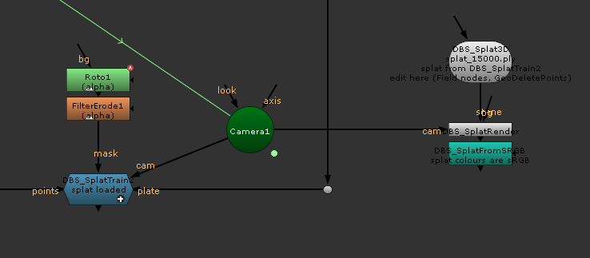
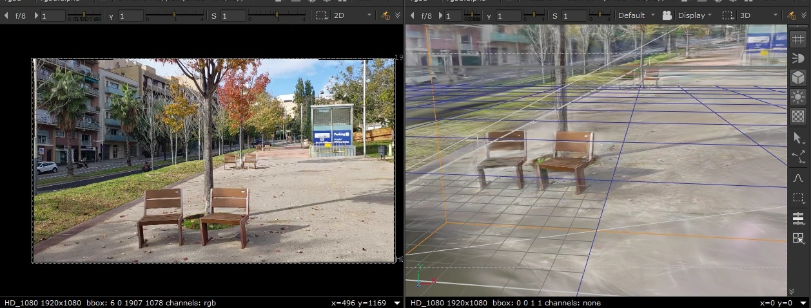

# DBS_SplatTrain

By David Borrull, VFX compositor. MIT licence (see LICENSE). Provisional name.

Nuke node: train a Gaussian splat from a shot that is already tracked in
Nuke, and bring it back aligned with the track camera.

```
Nuke     render every Nth frame (+ masks of what moves), CameraTracker camera per frame,
         tracker point cloud -> COLMAP binary (sparse/0) or transforms.json
  -> Brush (separate process, command line) trains the splat -> .ply
  -> Nuke 17 splat node, in the track's world
```

## Install

In `~/.nuke/menu.py`:

```python
nuke.pluginAddPath("C:/path/to/DBS_SplatTrain/nuke")
import DBS_SplatTrain
DBS_SplatTrain.install_menu()
```

The node is then in the Nodes toolbar under **DBS > DBS_SplatTrain** (and in **3D**). Brush
v0.3.0 for Windows goes in `bin/brush-v0.3.0/brush_app.exe` (not in the repo; download it from
the Brush releases page), or set its path on the node.

## Use


1. Connect the plate to `plate`, the tracked camera to `cam`, the CameraTracker's point cloud to
   `points` and, if something moves, a roto of it (alpha) to `mask`. The plate must be
   undistorted (the cameras are pinhole).
2. Save the script: the export reads it from disk (the node saves it again if it has changes).
3. Press **Export + Train**. Progress shows under the buttons and in the node's label;
   Nuke stays usable. `stop` ends the current step.
4. When training ends, the node outputs the splat rendered through `cam`, in the working colour
   space (`show splat` off: the plate passes through). There is no load button: the node shows
   whatever `.ply` is in `splat`, so picking one by hand shows it too.

Or step by step: **1. export** (frames every N, cameras, tracker points), **2. train** (Brush). Files go to `work folder`, by default
`<script folder>/DBS_SplatTrain/<node name>/`: `dataset/`, `splats/splat_<steps>.ply`,
`export.log`, `train.log`.

Timing on an RTX 4060 Ti (8 GB): export about 1 min for 80 frames at 1920x1080; training 30000
steps about 20 min.

The node outputs an image, so the splat itself is not in the 3D viewer. **create 3D setup** puts
it next to the node as GeoImport -> SplatRender (through the same camera) -> OCIOColorSpace, to
see and edit it in 3D: e.g. to remove part of it, a GeoDeletePoints between GeoImport and
SplatRender with a FieldShape in its mask.





A mask is for things that move: Brush ignores those pixels and learns the background from the
frames where it is visible. It does not remove a static object (e.g. a lamppost masked in every
frame): nothing is learned behind it, and a soft ghost stays where it was. Delete that in the 3D
setup, or clean the plate in 2D before training.

### Proxy

Under `splat` the panel shows how many splats it has and the file size. A splat of 300k splats or
more makes the 3D viewer slow: **make proxy** writes a lighter copy next to it with the size as a
suffix (`splat_30000_500k.ply`, never over the original), keeping the most visible splats
(opacity x area). Sizes: 500k, 100k or custom. **use proxy** swaps it in, in the node and in
the 3D setups it made, and the node's label says `proxy`: renders use it too, so turn it off for
the final render. It takes under a second for 300k splats; 100k keeps the picture
but loses the finest detail (grass).

The proxy knobs are on nodes created from this version on: older nodes keep working without them.

### Colour

Brush learns from sRGB PNGs. The export writes the plate through the OCIO role `texture_paint`
(sRGB in Nuke's default and ACES configs) and the node turns the rendered splat back from it to
`scene_linear`, so it matches the plate in any working space.

### Command line

The node runs these; they also work by hand:

```
"C:/Program Files/Nuke17.1v1/Nuke17.1.exe" --nc -t tools/DBS_export_shot.py shot.nk Read1 Camera1 work/shot ^
    --points=CameraTrackerPointCloud1 --mask=Roto1 --first=1001 --last=1100 --step=2
python tools/DBS_train_brush.py work/shot --steps 7000
```

- Write options as `--step=2`: Nuke takes a loose number on its command line as a frame range.
- Non-square pixels (e.g. 1280x1080 at 1.5) are stretched to square (1920x1080).
- Do not leave a `.ply` inside the dataset folder: Brush uses it as the initial splat.

### Nuke Non-commercial

Python may touch only 10 nodes per session, so the buttons work from their own node and reach
the rest by name; the export runs in a separate Nuke terminal.

## Planned

Ideas, not implemented yet:

- **Set photos.** Add still photos of the set (sharper, from more angles) to the shot's frames.
  COLMAP would register them into the track's world, with the track cameras kept fixed, and
  Brush (or Postshot) would train on both. Mixing photos and video will need COLMAP: neither
  Brush nor Postshot registers new photos against imported cameras (Postshot ignores images
  without a pose).
- **Postshot from inside Nuke.** Pick Postshot in the node's `trainer` menu, next to Brush, and
  train with it without leaving Nuke: same dataset, same masks, the splat back in the node.
  Postshot's command line needs a Postshot Studio licence.

## Brush notes (v0.3.0)

- Formats: COLMAP (checked first) and nerfstudio transforms.json. The exporter writes COLMAP
  binary.
- Masks: `masks/<image name>.*` (black = ignored in the loss), or image alpha (then the splat is
  trained to match the transparency). v0.3.0 has no `--invert-masks`.
- Initial splats: COLMAP points3D, `ply_file_path` in transforms.json, or any `.ply` in the
  dataset; random otherwise.
- Brush keeps the dataset's world: no recentring or rescaling (`tests/synthetic_brush.py`).
- v0.3.0 bug: any image file under 16 KB fails the whole load with "early eof". Masks are
  written as PNG with under 1 % of noise to
  stay above it (v0.3.0 does not read TIFF).
- Training flag is `--total-steps` (later versions: `--total-train-iters`).

## Tests

`python tests/test_dataset.py` (plain Python), and `python tests/synthetic_brush.py work/synth`
(numpy, Pillow, Brush: trains a synthetic box and checks the splat lands on it, about 20 s).

`python tools/DBS_decimate_splat.py splat.ply --keep=100000` makes a proxy by hand.
`python tools/make_icon.py` and `python tools/make_banner.py` redraw the icon and the banner.
